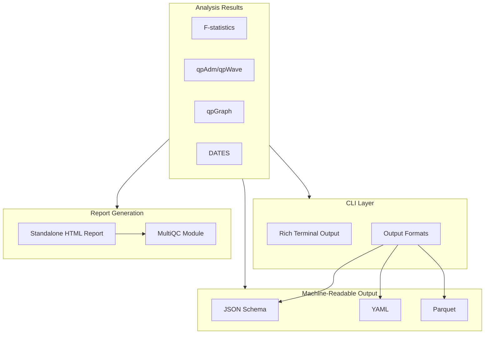

# Popmix Ergonomics and Reporting Enhancement Plan

## CRITICAL: TDD-First Development

**ALL development in this plan MUST follow Test-Driven Development (TDD).** No code is written without a failing test first. This applies to every function, class, and module.

## Goals

1. **TDD-first** - Tests before implementation for ALL features
2. **Beautiful visualizations** - Rich terminal output and interactive HTML reports
3. **Machine-readable formats** - JSON, YAML, Parquet for pipeline integration
4. **MultiQC integration** - Custom module for population genetics analyses
5. **Statistical rigor** - Confidence intervals, effect sizes, clear significance thresholds

---

## Architecture Overview



---

## Phase 0: TDD Foundation

Establish TDD-first development practices before any implementation begins.

### New Rule File: [.cursor/rules/008-tdd-first.mdc](.cursor/rules/008-tdd-first.mdc)

Create a comprehensive TDD rule that applies to ALL development:

```yaml
---
description: TDD-first development methodology - MANDATORY for all popmix development
globs:
  - "**/*.py"
  - "**/*.rs"
alwaysApply: true
---
```

Content should include:

1. **The TDD Cycle**: RED (failing test) -> GREEN (minimum code) -> REFACTOR
2. **Test Categories**: Unit, Integration, Golden master, CLI tests
3. **Examples** for CLI formatting, HTML reports, MultiQC modules
4. **Commit Rules**: Never commit code without tests

### Update [CLAUDE.md](CLAUDE.md)

Add TDD-first section prominently near the top:

```markdown
## MANDATORY: TDD-First Development

**Every feature, bug fix, and refactor starts with a failing test.**

1. **Write test** that describes expected behavior
2. **Run test** - confirm it fails
3. **Write code** - minimum to pass
4. **Run test** - confirm it passes
5. **Refactor** - improve while staying green
6. **Commit** - test + implementation together

See `.cursor/rules/008-tdd-first.mdc` for detailed patterns.
```

### Files to Create/Update

| File | Action |

|------|--------|

| `.cursor/rules/008-tdd-first.mdc` | Create - TDD methodology rule |

| `CLAUDE.md` | Update - Add TDD-first section at top |

| `.cursor/rules/004-testing.mdc` | Update - Reference 008-tdd-first.mdc |

---

## Phase 1: Rich Terminal Output

Upgrade CLI from plain `click.echo()` to Rich library for beautiful terminal output.

### TDD Workflow

1. Create `tests/python/test_rich_output.py` with tests for each formatter
2. Run tests - all should fail (RED)
3. Implement `python/popmix/cli/rich_output.py`
4. Run tests - all should pass (GREEN)
5. Refactor for clarity

### Key Components

| Component | Description |

|-----------|-------------|

| `python/popmix/cli/rich_output.py` | Rich console, tables, panels, progress bars |

| Colored significance | Green/yellow/red Z-score thresholds |

| Progress bars | Long-running operations (extract-f2, dates) |

| Result panels | Box-formatted results with headers |

### Example Output Improvement

**Before:**

```
qpAdm: French = mix of Yamnaya, Anatolia_N
Admixture weights:
  Yamnaya: 0.4523 (45.2%)
  Anatolia_N: 0.5477 (54.8%)
Model fit: chi-sq=4.23, df=3, p=0.237
```

**After:**

```
+-----------------------------------------------------------+
|  qpAdm: French = Yamnaya + Anatolia_N                     |
+-----------------------------------------------------------+
|  Source          Weight     95% CI           SE           |
|  Yamnaya         45.2%    [38.1%, 52.3%]    +/-3.6%       |
|  Anatolia_N      54.8%    [47.7%, 61.9%]    +/-3.6%       |
+-----------------------------------------------------------+
|  Model Fit       X2=4.23   df=3   p=0.237  [PASS]         |
|  Feasibility     All weights in [0,1]      [VALID]        |
+-----------------------------------------------------------+
```

---

## Phase 2: Machine-Readable Output Formats

Create standardized output schemas for pipeline integration.

### TDD Workflow

1. Create `tests/python/test_formatters.py` with schema validation tests
2. Create `tests/python/test_output_files.py` for file output tests
3. Implement formatters after tests fail

### JSON Schema (`python/popmix/schemas/`)

Define JSON schemas for all result types:

- `f2_result.json`, `f3_result.json`, `f4_result.json`
- `qpadm_result.json`, `qpwave_result.json`
- `dates_result.json`, `graph_result.json`

### Output Format Options

| Format | Extension | Use Case |

|--------|-----------|----------|

| `json` | `.json` | Structured, nested data |

| `yaml` | `.yaml` | Human-readable config |

| `tsv` | `.tsv` | Spreadsheet import |

| `parquet` | `.parquet` | High-performance analytics |

| `ndjson` | `.ndjson` | Streaming/line-by-line processing |

### File Output Option

Add `--output-file` / `-o` option to all commands:

```bash
popmix qpadm ... --format json -o results/qpadm_french.json
popmix dates ... --format parquet -o results/dates.parquet
```

---

## Phase 3: Statistical Rigor Standards

### TDD Workflow

1. Write tests asserting CI presence in all result types
2. Write tests for significance threshold coloring
3. Implement statistical enhancements

### Reporting Requirements

Every statistical result must include:

1. **Point estimate** with standard error
2. **Confidence interval** (95% by default, configurable)
3. **Effect size** (when applicable)
4. **Sample size / SNP count / block count**
5. **Significance assessment** with clear thresholds

### Significance Thresholds

| Z-score | Interpretation | Color |

|---------|----------------|-------|

| |Z| < 2 | Not significant | Gray |

| 2 <= |Z| < 3 | Marginally significant | Yellow |

| |Z| >= 3 | Significant | Green/Red |

### Model Quality Indicators

For qpAdm/qpWave:

- **p-value thresholds**: p > 0.05 good, p > 0.01 acceptable, p <= 0.01 poor
- **Feasibility**: weights in [0,1] for constrained models
- **Rank confidence**: show all rank test p-values

---

## Phase 4: Standalone HTML Reports

Create interactive HTML reports for comprehensive analysis summaries.

### TDD Workflow

1. Create `tests/python/test_html_reports.py`
2. Test HTML structure, Plotly inclusion, data rendering
3. Implement report generator

### Report Generator (`python/popmix/reports/`)

| File | Purpose |

|------|---------|

| `html_report.py` | Main report generator using Jinja2 |

| `templates/base.html` | Base template with Plotly.js |

| `templates/qpadm.html` | qpAdm-specific visualizations |

| `templates/dates.html` | DATES LD decay plots |

| `plots.py` | Plotly figure generation |

### Visualizations

| Analysis | Visualization |

|----------|---------------|

| F-statistics | Heatmap matrix, bar charts with error bars |

| qpAdm | Stacked bar chart, forest plot of weights |

| qpWave | Rank test ladder plot |

| DATES | LD decay curve with exponential fit |

| qpGraph | Interactive graph visualization (D3.js) |

### CLI Integration

```bash
popmix qpadm ... --report qpadm_french.html

popmix report \
  --f2-dir f2_blocks/ \
  --analyses results/*.json \
  --output analysis_report.html
```

---

## Phase 5: MultiQC Integration

Create a MultiQC custom module for popmix results.

### TDD Workflow

1. Create `tests/python/test_multiqc_module.py`
2. Test file detection, parsing, report generation
3. Implement MultiQC module

### Module Structure (`python/popmix/multiqc/`)

```
multiqc/
  __init__.py
  popmix_module.py      # Main MultiQC module
  templates/
    popmix_report.html
  search_patterns.yaml   # File pattern matching
```

### MultiQC Features

1. **General Statistics columns**: F2/FST values, qpAdm p-values, DATES estimates
2. **Custom sections**: Population matrix, qpAdm summary table, DATES timeline
3. **Output files detected**: `*_popmix_stats.json`, `*_qpadm.json`, `*_dates.json`

### Installation

```bash
pip install popmix[multiqc]
multiqc results/ --module popmix
```

---

## Phase 6: Batch Analysis Mode

Add batch mode for analyzing multiple targets efficiently.

### TDD Workflow

1. Create `tests/python/test_batch_mode.py`
2. Test config parsing, parallel execution, report aggregation
3. Implement batch commands

### Batch Commands

```bash
popmix qpadm-batch \
  -i data \
  --targets targets.txt \
  --left sources.txt \
  --right outgroups.txt \
  --output-dir results/ \
  --report batch_report.html

popmix dates-batch \
  -i data \
  --config dates_config.yaml \
  --output-dir results/
```

---

## Implementation Files

### New Files

| Path | Purpose |

|------|---------|

| `.cursor/rules/008-tdd-first.mdc` | TDD methodology rule |

| `tests/python/test_rich_output.py` | Rich output tests |

| `tests/python/test_formatters.py` | Format handler tests |

| `tests/python/test_html_reports.py` | HTML report tests |

| `tests/python/test_multiqc_module.py` | MultiQC tests |

| `python/popmix/cli/rich_output.py` | Rich console utilities |

| `python/popmix/cli/formatters.py` | Output format handlers |

| `python/popmix/schemas/` | JSON schema definitions |

| `python/popmix/reports/` | HTML report generation |

| `python/popmix/multiqc/` | MultiQC module |

### Modified Files

| Path | Changes |

|------|---------|

| [CLAUDE.md](CLAUDE.md) | Add TDD-first section |

| [.cursor/rules/004-testing.mdc](.cursor/rules/004-testing.mdc) | Reference TDD rule |

| [python/popmix/cli/__init__.py](python/popmix/cli/__init__.py) | Integrate Rich, add output options |

| [pyproject.toml](pyproject.toml) | Add optional dependencies |

---

## Dependencies

Add to `pyproject.toml`:

```toml
[project.optional-dependencies]
cli = [
    "click>=8.0",
    "rich>=12.0",
]
reports = [
    "jinja2>=3.0",
    "plotly>=5.0",
]
multiqc = [
    "multiqc>=1.20",
]
all = [
    "popmix[cli,reports,multiqc]",
]
```

---

## Success Criteria

1. **TDD compliance** - Every feature has tests written BEFORE implementation
2. **Terminal output** uses Rich for all commands with colored tables and progress bars
3. **All formats** (JSON, YAML, TSV, Parquet) work for all commands
4. **HTML reports** render correctly with interactive Plotly charts
5. **MultiQC** recognizes popmix output files and displays summary statistics
6. **Statistical reporting** includes CIs, effect sizes, and clear significance indicators
7. **Documentation** updated with examples of all output formats
8. **Test coverage** - All new code has >90% test coverage